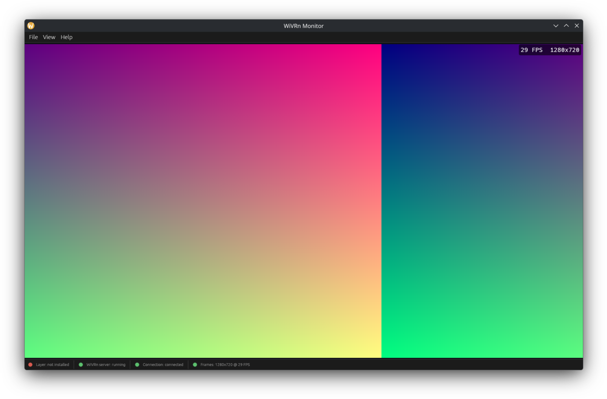

# WiVRn Monitor

See on your PC what's happening inside your VR headset.

WiVRn Monitor is a small program for Linux. It opens a normal window on your desktop and shows you live
what the person wearing the headset sees. It works with [WiVRn](https://github.com/WiVRn/WiVRn), the program
that streams VR from your Linux PC to a headset like the Meta Quest.

If you know "Display VR View" from SteamVR: it's that idea, for WiVRn.

# What it's good for

- **Watching along.** Friends or family can see what you're doing in VR.
- **Streaming and recording.** Capture the window in OBS like any other window.
- **Helping someone.** You can see what the other person sees and guide them.
- **Showing VR to others.** Handy for demos and first-time VR users.

# Features

- Shows everything you see in the headset: games, apps, menus and overlays.
- Shows the right eye, cut to a normal widescreen picture (16:9).
- Can record the picture as an MP4 video, with sound (microphone and app sound; see [Recording](#recording)).
- A status bar tells you if everything is ready.
- WiVRn itself stays untouched. Nothing is rebuilt or replaced.
- One single file to download. No admin rights (root) needed.

# What you need

- A Linux PC with WiVRn already set up and working.
- A graphics card that supports Vulkan (practically every card that can run VR does).
- A Linux that's not too old: Ubuntu 22.04 or newer, or a similarly recent distribution.

**What has been tested:** WiVRn server 26.9 on Arch Linux / CachyOS with the KDE desktop (Wayland).

**What hasn't been tested yet:** other distributions and desktops, X11, and other WiVRn versions.
It may well work there, but nobody has checked yet. WiVRn Monitor notices when a WiVRn version is built
differently inside and then simply stays off. If that happens to you, please open an issue.

# Getting started

## 1. Download

Go to the **Releases** page of this repository and download `WiVRn-Monitor-x86_64.AppImage`.

An AppImage is a program in a single file. You don't need to install it.

## 2. Make it executable

Linux needs your permission before it runs a downloaded program. Do one of these:

- In your file manager: right-click the file → **Properties** → **Permissions** → tick **"Allow executing file as program"**
  (the exact wording depends on your desktop).
- Or in a terminal, in the folder where the file is:

      chmod +x WiVRn-Monitor-x86_64.AppImage

## 3. Start it and install the layer

Double-click the AppImage. The WiVRn Monitor window opens.

In the menu, click **File → "Install layer"**.

The "layer" is a small add-on that WiVRn loads when it starts. It hands the picture over to the window.
It's only stored in your own home folder.

You only need to do this once.

## 4. Restart WiVRn

Restart the WiVRn server once, for example via the WiVRn dashboard. WiVRn only picks up the add-on when it starts.

## 5. Play

Connect your headset as usual and start a VR app or game. The picture appears in the window.

You can open and close the window at any time. It connects by itself.

# Recording

WiVRn Monitor can record what arrives in the window as a video (the picture only: no menu, no FPS display), **with sound**.

> **Privacy: the microphone is recorded too, and this is ON by default.** Everything you say while recording ends up in the
> video file, next to the sound of your apps. To record without it, untick **Record → Microphone** (or **Record audio** to
> get a video without any sound). The choice is remembered. A recording shows "REC 00:12 · audio" in the status bar whenever sound is included.

- **Where:** in `~/Videos/VR` (created automatically), named like `VR_2026-11-13_20-21-15.mp4`. It is a normal MP4 (H.264) that plays everywhere.
- **Start / stop:** menu **Record → "Start recording" / "Stop recording"**, or press **F9**. While recording, a red dot and
  "REC 00:12" show in the status bar and in the corner of the picture.
- **Automatically:** tick **Record → "Record automatically when VR frames arrive"** (off by default, remembered). Recording then
  starts with the first picture and ends when the VR session ends or no pictures arrive for 5 seconds. The next session gets a new file.
- **Open the folder:** **Record → "Open recordings folder"**.
- **Sound:** menu **Record → "Record audio"** (main switch, on by default) with two options below it:
  **"Microphone"** (your default input device; with WiVRn usually the headset microphone) and **"App sound"** (everything that is
  played on your default output device, so game sound too). Both are mixed into **one stereo track** (AAC, 48 kHz), so every player
  plays it without choosing a track; the microphone is placed in the middle. Changes apply to the **next** recording (the options
  are greyed out while recording). If a WiVRn audio device exists (a name containing "wivrn"), it is used instead of the default.
  Your system's default devices are never changed. To pick other devices, set `WIVRN_MONITOR_AUDIO_SINK` (the output whose sound is recorded)
  and/or `WIVRN_MONITOR_AUDIO_SOURCE` (the microphone) to a name from `pactl list short sinks` / `sources`.
  If sound is not possible (no PulseAudio/PipeWire audio, no device), the video is recorded without sound and the status bar says so.
  With sound on, pauses without pictures stay in the video (the sound does not stop), so very long pauses are shown as a frozen picture.
- **Size:** about 1 minute = up to 60 MB (1280x720, 30 FPS; quiet scenes need less); sound adds about 1.2 MB per minute. Make sure there is free disk space.
- If the disk is full or the folder is not writable, recording stops with a message and the window keeps running.
  Files stay playable even if the program or PC crashes (you lose at most the last second).

# The status bar

At the bottom of the window you see if everything is ready:

| Shows | Means |
|---|---|
| **Layer:** installed | The add-on is installed. "not installed" or "outdated – reinstall": click File → "Install layer" and restart WiVRn. |
| **WiVRn server:** running | WiVRn is running. If not, start WiVRn. |
| **Connection:** connected | WiVRn and the window are talking to each other. "waiting" means: no VR session yet, or WiVRn hasn't been restarted since installing. |
| **Frames:** size and FPS | Pictures are arriving. FPS = pictures per second. |

The small FPS display in the picture can be turned off under **View → "FPS overlay"**.

# Uninstall

1. Click **File → "Uninstall layer"**.
2. Restart WiVRn once.
3. Delete the AppImage file.

That's it. Everything was stored only in your home folder. Nothing was changed in WiVRn or the system.

# FAQ

### Does this make VR slower?

It shouldn't be noticeable. The extra work is small and only happens while the window is open and connected.
This hasn't been measured precisely, though.

### Can this break my headset or WiVRn?

It doesn't change anything in WiVRn or on your headset. But to be honest: the add-on runs inside WiVRn.
If there's a bug in it, WiVRn could crash. Then just restart WiVRn. If it keeps happening,
uninstall the layer (see above) and please open an issue.

### Does it work with game X?

It works with everything that runs through WiVRn. It shows the finished picture, no matter which app it comes from.

### Why only one eye, and why is a bit missing at the top and bottom?

A headset shows a slightly different picture to each eye. For a normal screen, one eye is enough.
The picture is cut to widescreen (16:9) so it fills the window nicely. That's why a little is missing at the top and bottom.

### I installed it, but the window stays empty.

Check the status bar. Most of the time WiVRn just needs to be restarted once after installing.
More help is in [docs/TECHNICAL.md](docs/TECHNICAL.md#troubleshooting).

### The title bar shows a generic icon instead of the dragon.

That can happen on KDE. It's only cosmetic and doesn't affect anything.

# Known limitations

- Only the right eye is shown.
- The picture is cut to 16:9. A bit is missing at the top and bottom.
- After installing or uninstalling, WiVRn has to be restarted once.
- On KDE, the title bar may show a generic icon.

# Credits

- The icon was generated with AI and is inspired by the WiVRn mascot.
- [WiVRn](https://github.com/WiVRn/WiVRn) is a separate project. WiVRn Monitor is unofficial and not affiliated with WiVRn.
  Without WiVRn, none of this would exist. Thanks to everyone working on it!
- Sound encoding uses the pure Rust AAC encoder [filmcraft-aac](https://crates.io/crates/filmcraft-aac) (MIT OR Apache-2.0); see [docs/TECHNICAL.md](docs/TECHNICAL.md#sound) for the patent note.
- Video encoding uses [Cisco OpenH264](https://github.com/cisco/openh264) (BSD-2-Clause), built from source into the program; see [docs/TECHNICAL.md](docs/TECHNICAL.md#recording) for the patent note.

# For developers

- [docs/TECHNICAL.md](docs/TECHNICAL.md) – how it works, settings (environment variables), troubleshooting with the log file.
- [docs/DEVELOPMENT.md](docs/DEVELOPMENT.md) – building, AppImage, CI/releases, tests.
